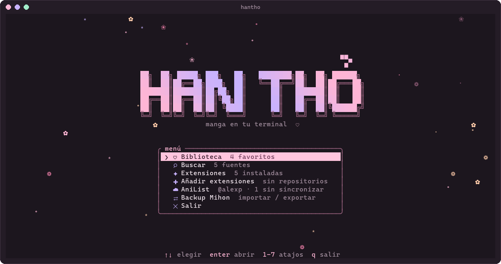
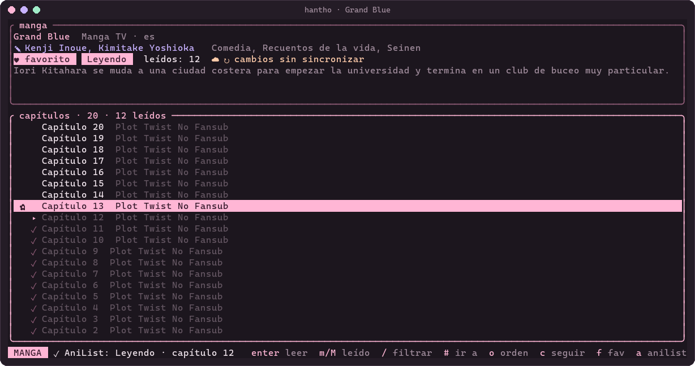
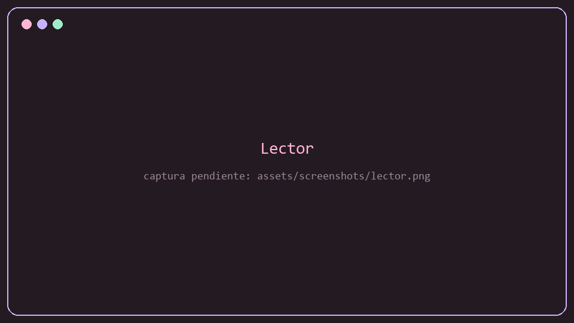
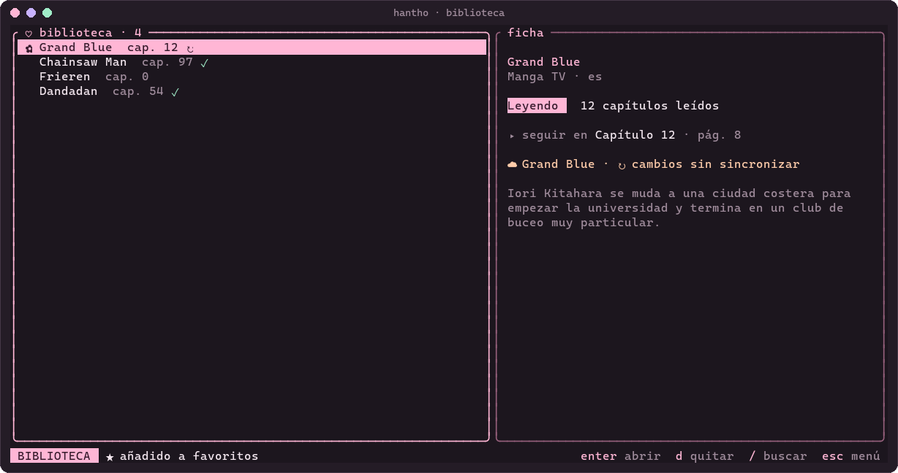
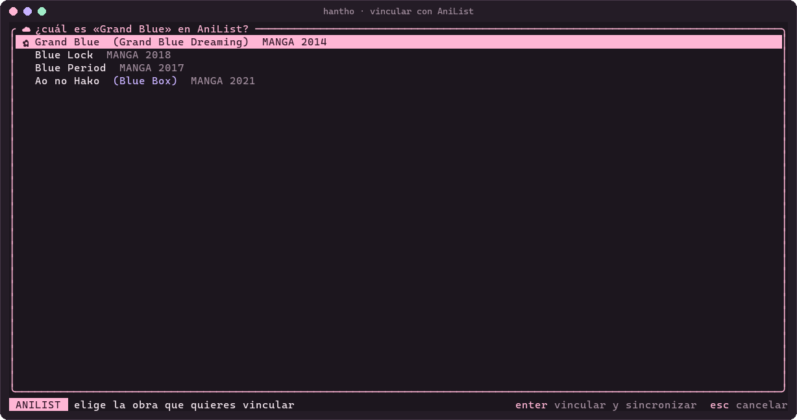
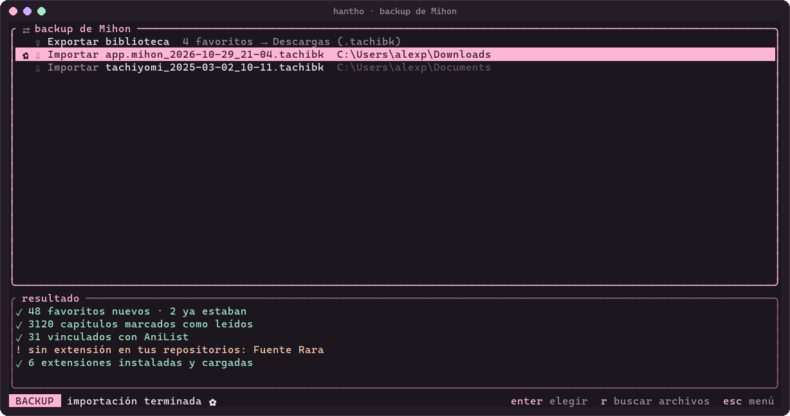
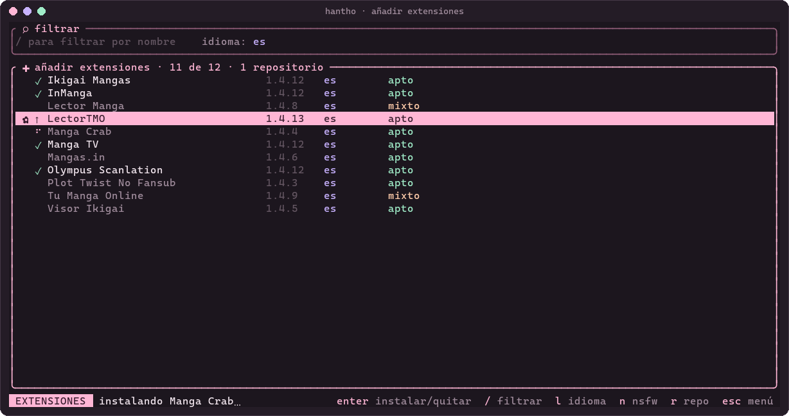
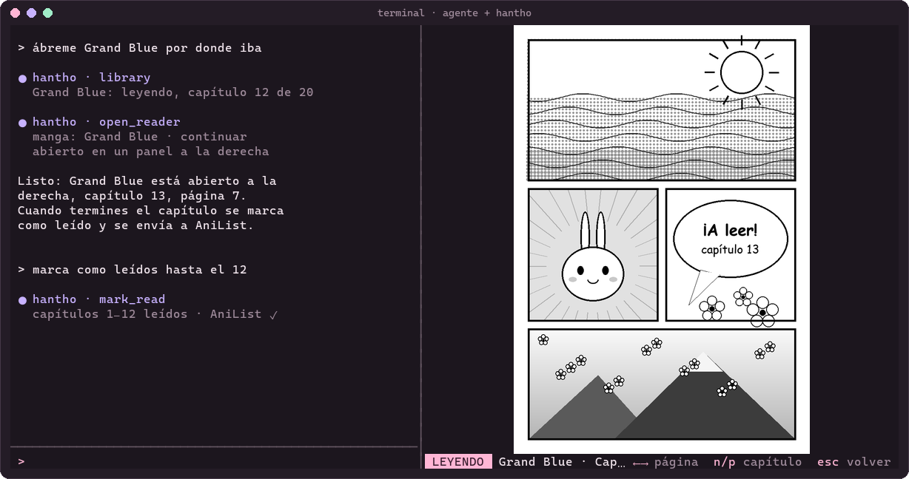
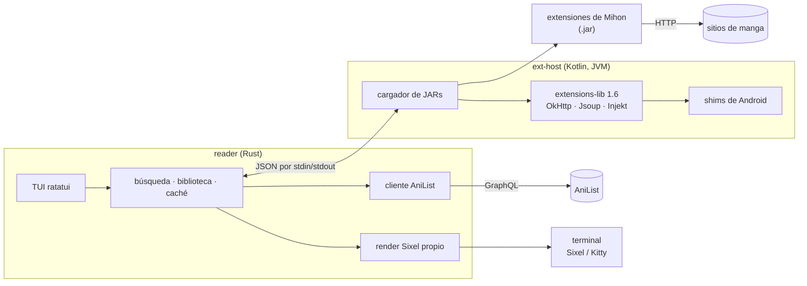

<div align="center">


# Han Thỏ

**Manga en tu terminal, con las extensiones de Mihon y un toque de sakura.**

[](https://github.com/AlPeFe/mangaterm/actions/workflows/ci.yml)
[](LICENSE)


</div>

---

**Han Thỏ** (en la terminal, `hantho`) es un lector de manga para la terminal. Busca en todas tus fuentes a la vez usando las
mismas extensiones que [Mihon](https://github.com/mihonapp/mihon) en Android (las del repositorio
que tú añadas), muestra las páginas como imágenes de verdad
(Sixel o Kitty) y lleva tu progreso a [AniList](https://anilist.co).

### ¿Por qué?

- **Sin salir de la terminal.** Si vives en una consola (o trabajas por SSH), no hace falta abrir el navegador
  ni el móvil para leer un capítulo.
- **El ecosistema de Mihon, en el escritorio.** En lugar de reescribir scrapers, Han Thỏ ejecuta las
  extensiones existentes (más de 1400, en 150 idiomas) en una JVM normal. Cuando una fuente cambia,
  se actualiza la extensión y ya está.
- **Pensado para manga.** Un render Sixel propio, ajustado para páginas en blanco y negro: sin moiré en
  las tramas ni ruido de dithering.

## Funciones

- 🌸 **TUI** con tema rosa pastel, pantalla de inicio animada, biblioteca, extensiones y AniList.
- 🔎 **Búsqueda global** en todas las fuentes instaladas en paralelo (≈165 fuentes en español en ~25 s),
  con resultados agrupados por obra.
- 📖 **Lector** con imágenes Sixel o Kitty; fallback a bloques de color si la terminal no tiene gráficos.
  Precarga de páginas siguientes.
- 💗 **Biblioteca**: favoritos, estado de lectura (leyendo, en pausa, completado…), "continuar" donde lo dejaste.
- ✓ **Capítulos leídos**: se marcan solos al terminar un capítulo y se ven apagados en la lista; en mangas
  de mil capítulos, filtra (`/`), salta a un número (`#`) o avanza de cien en cien.
- 🧩 **Extensiones**: como en Mihon, Han Thỏ no trae ninguna. Añades el repositorio que quieras y
  desde *Añadir extensiones* filtras por nombre, idioma o NSFW e instalas con `enter`.
- ☁️ **AniList**: login por navegador sin copiar nada; cada manga se vincula con su obra (solo si es una
  coincidencia exacta, o eligiéndola tú) y el progreso se envía al terminar capítulos. Nunca retrocede.
- ⇄ **Backups de Mihon**: importa un `.tachibk` (favoritos, leídos, vínculos con AniList; instala solas las
  extensiones que falten) y exporta tu biblioteca para restaurarla en Mihon.
- 🤖 **Servidor MCP**: Claude Code, Codex y otros agentes pueden buscar, consultar tu biblioteca, marcar
  capítulos y abrir el lector en un panel al lado del chat ([`docs/mcp.md`](docs/mcp.md)).
- 🐢 **Respetuoso con los servicios**: rate limiting y caché tanto para AniList como para las fuentes.
- 🐧🪟 **Linux y Windows**, probado en CI en ambos.

## Capturas

| Inicio | Búsqueda global |
|---|---|
|  |  |
| **Capítulos** (los leídos, apagados) | **Lector** (Sixel) |
|  |  |
| **Biblioteca** | **Vincular con AniList** |
|  |  |
| **Backup de Mihon** | **Añadir extensiones** |
|  |  |

**Con un agente (MCP):** el lector se abre en un panel al lado del chat.



<sub>Capturas generadas desde la propia TUI con `python tools/screenshots.py`; la página del lector
es un dibujo de ejemplo.</sub>

## Requisitos

- **Java 21** (JDK) para compilar y correr `ext-host`.
- **Rust** estable (edición 2024).
- Una terminal con imágenes:

  | Protocolo | Terminales |
  |---|---|
  | **Sixel** (recomendado) | Windows Terminal ≥ 1.22, foot, WezTerm, Konsole, xterm (`-ti vt340`), mlterm |
  | **Kitty** | kitty, Ghostty, WezTerm |
  | iTerm2 | iTerm2, WezTerm |
  | Bloques de color | cualquier terminal con color (fallback, se ve pixelado) |

## Instalación

Por ahora se compila desde el código. Son dos piezas: `ext-host` (Kotlin) y `reader` (Rust).
El reader encuentra y lanza el host solo.

### Linux

```bash
# Debian / Ubuntu
sudo apt install openjdk-21-jdk git curl
# Arch
sudo pacman -S jdk21-openjdk git
# Fedora
sudo dnf install java-21-openjdk-devel git

curl https://sh.rustup.rs -sSf | sh
```

```bash
git clone https://github.com/AlPeFe/mangaterm.git
cd mangaterm
(cd ext-host && ./gradlew installDist)
(cd reader && cargo build --release)
```

### Windows

En PowerShell:

```powershell
winget install EclipseAdoptium.Temurin.21.JDK Rustlang.Rustup Git.Git Microsoft.WindowsTerminal
```

```powershell
git clone https://github.com/AlPeFe/mangaterm.git
cd mangaterm
cd ext-host; .\gradlew.bat installDist; cd ..
cd reader; cargo build --release; cd ..
```

Usa **Windows Terminal** (la consola clásica `conhost` no muestra imágenes).

El binario queda en `reader/target/release/hantho` (`hantho.exe` en Windows). Si lo mueves
fuera del repo, define `HANTHO_HOST_LIB` apuntando a `ext-host/build/install/ext-host/lib`.

## Uso

```bash
hantho
```

La primera vez no hay extensiones: entra en **Añadir extensiones**, pega la URL de un repositorio y
elige las que quieras. Vale la URL de su `index.pb` o `index.min.json`, la del repo en GitHub o un
enlace `tachiyomi://add-repo`. Han Thỏ carga las extensiones como `.jar`, así que el repositorio
tiene que publicarlas también en ese formato (como hace el de Keiyoushi); los que solo traen `.apk`
no sirven.

Lo mismo desde la línea de comandos:

```bash
hantho ext repo add <url-del-repositorio>
hantho ext install --lang es   # todas las extensiones en español
```

Desde la línea de comandos, sin TUI:

| Comando | Qué hace |
|---|---|
| `hantho search "grand blue" [--lang es]` | Busca en todas las fuentes instaladas |
| `hantho ext repo add\|remove <url>` / `ext repo list` | Gestiona tus repositorios de extensiones |
| `hantho ext update` | Descarga el catálogo más reciente de tus repositorios |
| `hantho ext find [texto] [--lang es] [--sfw]` | Busca extensiones en el catálogo |
| `hantho ext install <nombre…> [--lang es] [--sfw]` | Instala por nombre/paquete o todas las de un idioma |
| `hantho ext list` / `ext remove <paquete>` | Lista o desinstala extensiones |
| `hantho anilist login\|status\|logout` | Gestiona la cuenta de AniList (login por navegador) |
| `hantho open "título" [--continue\|--chapter N] [--side]` | Abre un favorito directamente en el lector (`--side`: en un panel al lado) |
| `hantho backup import <archivo.tachibk>` | Importa un backup de Mihon |
| `hantho backup export [--out archivo]` | Exporta la biblioteca a un `.tachibk` para Mihon |
| `hantho mcp` | Servidor MCP por stdio para agentes ([`docs/mcp.md`](docs/mcp.md)) |

### Teclas

En todas las listas funcionan `↑`/`↓` y `k`/`j`; `esc` o `q` vuelve atrás; `ctrl+c` sale.

| Pantalla | Teclas |
|---|---|
| Inicio | `1`–`7` o `enter` elegir · `/` buscar · `q` salir |
| Añadir extensiones | `enter` instalar, actualizar o quitar · `/` filtrar · `l` idioma · `n` ocultar NSFW · `r` añadir repositorio · `u` actualizar catálogo |
| Biblioteca | `enter` abrir · `d` quitar · `/` buscar |
| Búsqueda | escribe y pulsa `enter` · `tab`/`↓` ir a resultados · `/` editar · `b` biblioteca |
| Manga | `enter` leer · `c` continuar · `f` favorito · `e` estado · `a` vincular/sincronizar AniList · `A` re-vincular · `r` recargar |
| Capítulos | `m` marcar/desmarcar leído · `M` marcar este y los anteriores · `/` filtrar · `#` ir al capítulo N · `[`/`]` ±100 · `g`/`G` primero/último · `o` invertir orden |
| Backup Mihon | `enter` exportar o importar el archivo elegido · `r` buscar archivos de nuevo |
| AniList | `l` iniciar sesión · `o` cerrar sesión · `d` registrar la app (solo si falta el client ID) |
| Lector | `→` `espacio` `l` siguiente · `←` `h` anterior · `n`/`p` capítulo siguiente/anterior · `g`/`G` primera/última página |

### Variables de entorno

| Variable | Para qué |
|---|---|
| `HANTHO_HOME` | Carpeta de datos (por defecto `~/.hantho`) |
| `HANTHO_PROTOCOL` | Forzar `sixel`, `kitty`, `iterm2` o `halfblocks` |
| `HANTHO_FONT` | Tamaño de celda en píxeles, p. ej. `10x20`, si la detección falla |
| `HANTHO_HOST_LIB` | Ruta a `ext-host/lib` si el binario no está dentro del repo |
| `HANTHO_ANILIST_CLIENT_ID` | Client ID de AniList propio (solo si tu binario no trae uno) |
| `JAVA_HOME` | JVM a usar (si no, `java` del `PATH`) |

> El proyecto antes se llamaba *mangaterm*. Si tienes datos en `~/.mangaterm`, se mueven solos a
> `~/.hantho` la primera vez que abras `hantho`.

## AniList

1. **Inicia sesión.** En la TUI, ve a *AniList* desde el menú y pulsa `l` (o ejecuta
   `hantho anilist login`). Se abre el navegador, pulsas *Approve* y ya está: no hay que copiar ni
   pegar nada, ni salir de la TUI. `o` cierra la sesión.
2. **Vincula cada manga.** Tener la cuenta conectada no basta: Han Thỏ tiene que saber qué obra de
   AniList es cada favorito (el mismo título puede tener manga, novela y spin-offs). Al añadir un
   favorito se vincula solo si el título coincide exactamente; si no, abre el manga y pulsa `a` para
   elegir la obra (`A` la vuelve a elegir). Desde un agente, la herramienta MCP `link_anilist`.
3. **Lee.** Cada capítulo que terminas o marcas como leído actualiza AniList automáticamente.
   `a` también fuerza un envío, por ejemplo después de cambiar el estado con `e`.

El progreso **nunca retrocede**: si AniList tiene más capítulos marcados que Han Thỏ, se conserva
el de AniList. El token queda en `~/.hantho/anilist.json` (permisos `600` en Linux) y no sale de
tu máquina más que hacia AniList.

<details>
<summary><b>Cómo funciona el login</b></summary>

Es el *implicit grant* de OAuth de AniList. Durante el login, Han Thỏ escucha en
`http://localhost:47913/callback`, **solo en loopback**. AniList redirige ahí con el token en el
fragmento de la URL (`#access_token=…`), que nunca viaja por la red: la página lo lee, se lo pasa al
servidor local y lo borra del historial del navegador. El servidor se cierra en cuanto recibe el token,
o a los 5 minutos.

</details>

<details>
<summary><b>Si tu binario no trae client ID (forks, builds propios)</b></summary>

AniList exige que la app esté registrada. Los binarios del proyecto traen su client ID embebido (en
este flujo no hay secreto, así que el ID es público), y el usuario final no registra nada. Si
compilas un fork sin ID, la pantalla de AniList te guía para hacer el registro una sola vez:

1. `d` abre <https://anilist.co/settings/developer> → *Create New Client*.
2. Name `Han Thỏ`, Redirect URL `http://localhost:47913/callback`.
3. Pega el ID en la pantalla y pulsa `enter`. Se guarda para la próxima vez.

También sirve `hantho anilist login --client-id <ID>` o la variable `HANTHO_ANILIST_CLIENT_ID`.

</details>

**Rate limiting y caché.** Han Thỏ hace como mucho 1 petición cada 2 s a AniList (con ráfagas de 5),
respeta `Retry-After` y `X-RateLimit-Remaining`, y reintenta con espera ante un 429. Las búsquedas en
AniList se cachean una semana. Para las fuentes: las búsquedas se cachean 10 minutos y los detalles
y capítulos 30 minutos (`r` fuerza la recarga).

## Cómo funciona



- **Catálogo.** Cada repositorio que añades publica un índice (`index.pb`, protobuf con gzip, el
  formato de Keiyoushi) con sus extensiones y fuentes. Han Thỏ lo descarga e instala los `.jar` de
  las extensiones que eliges en `~/.hantho`.
- **ext-host.** Las extensiones son clases JVM normales (ya convertidas desde dex), pero esperan
  vivir en Android. `ext-host` provee la implementación real de la API
  [`extensions-lib`](https://github.com/keiyoushi/extensions-lib) 1.6 (la publicada son solo stubs),
  más OkHttp, Jsoup, kotlinx-serialization, Injekt y *shims* mínimos de las clases de Android que usan
  (`Context`, `SharedPreferences`, `Uri`, `Base64`, `androidx.preference`…).
- **Protocolo.** El reader lanza el host como subproceso y le habla con una línea JSON por petición
  (`{"id":1,"op":"ping"}` → `{"id":1,"result":"pong"}`). Las búsquedas a muchas fuentes corren en
  paralelo y van llegando a medida que responden.
- **Render.** `ratatui-image` detecta el protocolo y el tamaño de celda, pero escala con vecino más
  cercano y usa un dithering fuerte que en manga produce moiré. Por eso Han Thỏ codifica su propio
  Sixel: escala con Lanczos3 al tamaño exacto en píxeles y usa 64 grises sin dithering para páginas en
  blanco y negro (o 256 colores con dithering suave para color). Una página tarda ~25 ms.

Más detalles técnicos en [`NOTES.md`](NOTES.md).

## Limitaciones conocidas

- **Cloudflare.** Las fuentes protegidas por el desafío de Cloudflare no funcionan: en Android se
  resuelven con un WebView, y aquí no hay. En las pruebas, ~12 de 165 fuentes en español fallaron por esto.
- **Shims de Android incompletos.** Algunas extensiones usan clases que todavía no están
  (`android.webkit.CookieManager`, `android.util.LruCache`, `android.graphics.ColorMatrix`,
  `Uri.Builder`, `Dispatchers.Main`…) y fallan al cargar o al buscar.
- **Sin pantalla de ajustes de extensiones.** Las preferencias de cada fuente quedan en sus valores
  por defecto.
- **Sin descargas offline** ni aviso de capítulos nuevos (por ahora).
- **Panel lateral del MCP**: necesita una terminal que se pueda dividir (Windows Terminal, tmux, WezTerm,
  zellij o kitty); si no, el lector se abre en una ventana nueva.
- **macOS** no está probado; debería funcionar, pero no hay CI.

## Aviso legal

Han Thỏ es un **lector**: no aloja, distribuye ni indexa contenido. Todo el material lo sirven
sitios de terceros a través de extensiones de terceros. Han Thỏ no trae ningún repositorio ni extensión: cada
usuario añade los que elige, y Han Thỏ los descarga tal cual, sin modificarlos. Los autores de Han Thỏ no tienen relación con esos sitios ni con las
extensiones, y no se hacen responsables de su contenido ni por su legalidad en tu país.

Respeta los derechos de autor y, cuando puedas, apoya a los autores leyendo y comprando por canales
oficiales. Han Thỏ no está afiliado a Mihon, Tachiyomi, Keiyoushi ni AniList.

## Contribuir

¡Bienvenido! Echa un vistazo a [`CONTRIBUTING.md`](CONTRIBUTING.md). Aquí no se aceptan peticiones de fuentes nuevas:
eso va al repositorio de extensiones que uses.

## Créditos

- [**Keiyoushi**](https://github.com/keiyoushi/extensions) — las extensiones y la API
  `extensions-lib` que `ext-host` implementa.
- [**Mihon**](https://github.com/mihonapp/mihon) y el difunto **Tachiyomi** — el ecosistema de
  extensiones sobre el que se apoya todo esto.
- [**ratatui**](https://ratatui.rs) y [**ratatui-image**](https://github.com/benjajaja/ratatui-image) — la TUI
  y la detección de protocolos gráficos.
- [**icy_sixel**](https://github.com/mkrueger/icy_sixel), [**image**](https://github.com/image-rs/image),
  [**tokio**](https://tokio.rs), [**reqwest**](https://github.com/seanmonstar/reqwest), [**clap**](https://github.com/clap-rs/clap),
  [**prost**](https://github.com/tokio-rs/prost).
- [**OkHttp**](https://square.github.io/okhttp/), [**Jsoup**](https://jsoup.org),
  [**kotlinx.serialization**](https://github.com/Kotlin/kotlinx.serialization) e
  [**Injekt**](https://github.com/null2264/injekt) (fork de null2264) en el host.
- [**AniList**](https://anilist.co) por su API pública.

## Licencia

[Apache License 2.0](LICENSE). Las extensiones de Keiyoushi y `extensions-lib` también son Apache-2.0
y pertenecen a sus autores.
