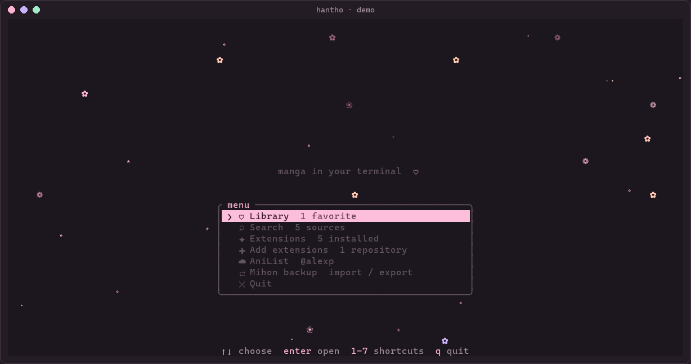
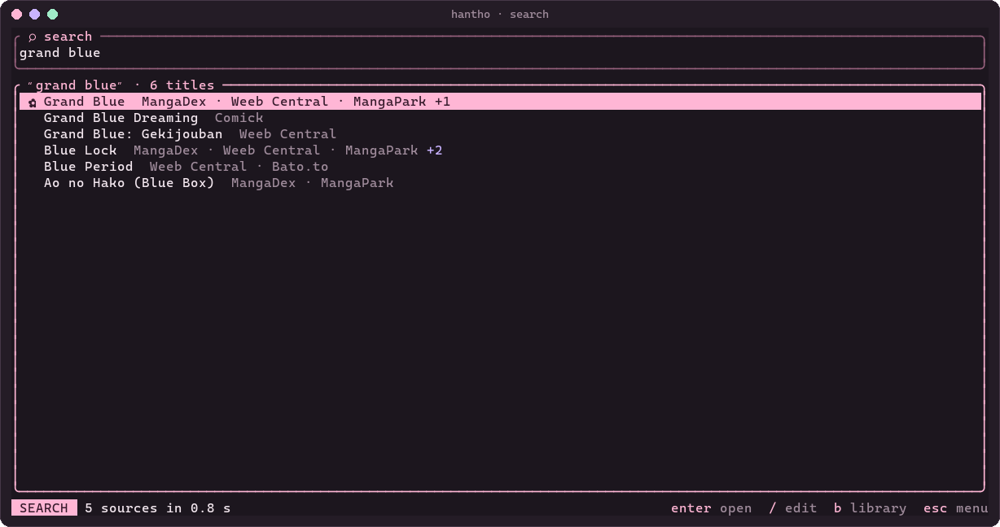
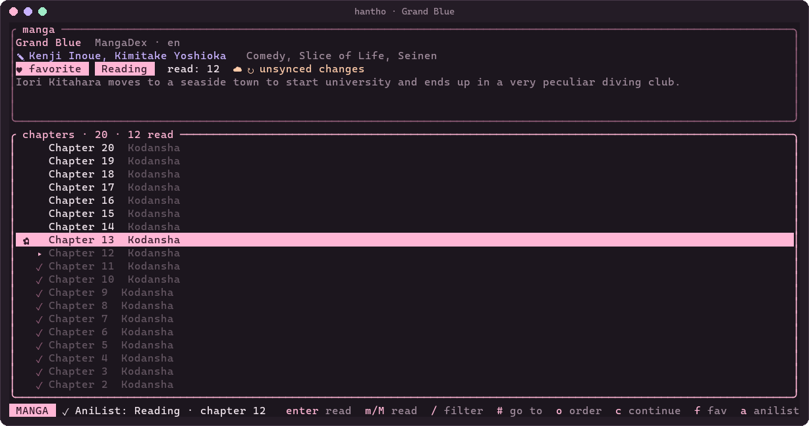
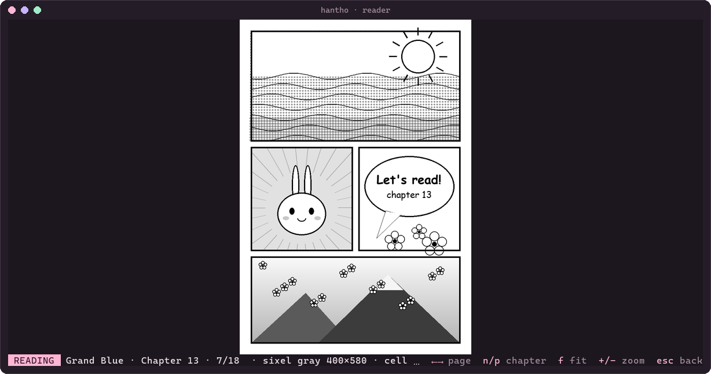
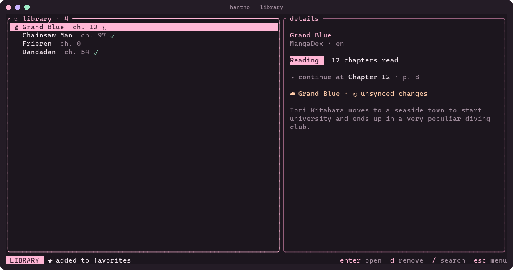
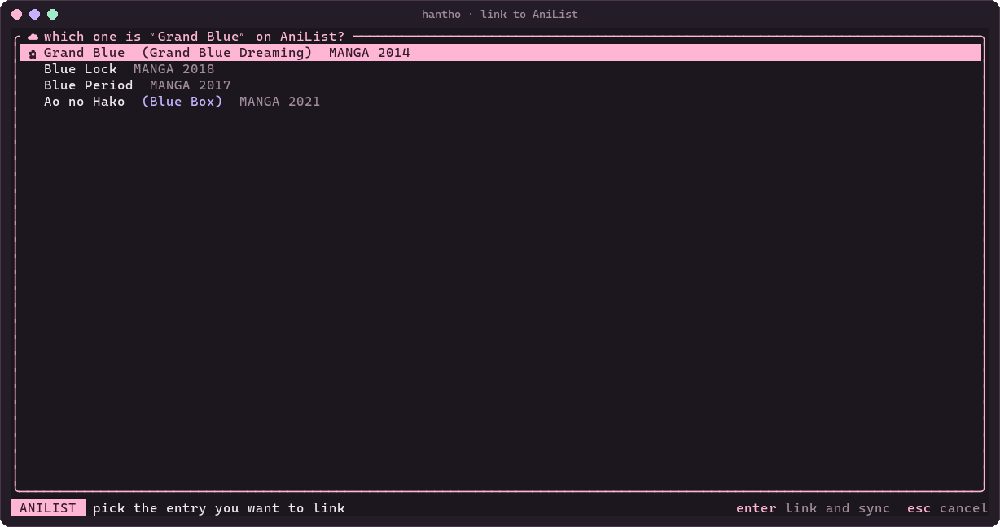
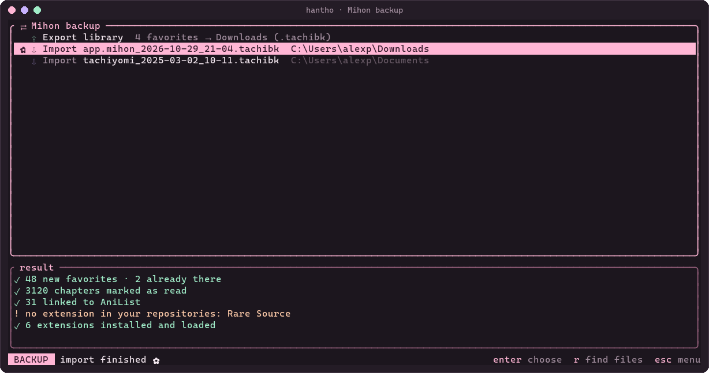
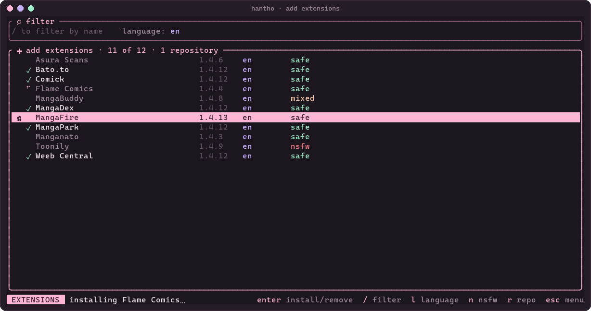
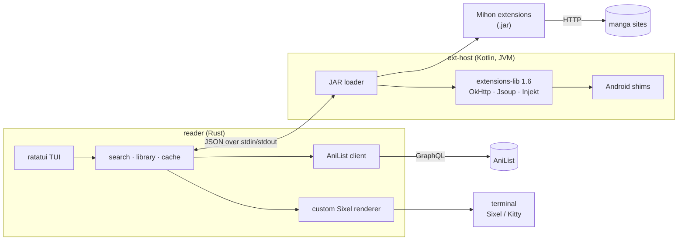

<div align="center">


# Han Thỏ

**Manga in your terminal, powered by Mihon extensions, with a touch of sakura.**

[](https://github.com/AlPeFe/hantho/actions/workflows/ci.yml)
[](LICENSE)


**English** · [Español](README.es.md)

</div>

---

**Han Thỏ** (`hantho` on the command line) is a manga reader for the terminal. It searches all your
sources at once using the same extensions as [Mihon](https://github.com/mihonapp/mihon) on Android
(from whichever repository you add), shows pages as real images (Sixel or Kitty) and syncs your
progress to [AniList](https://anilist.co).

<div align="center">

</div>

### Why?

- **Never leave the terminal.** If you live in a console (or work over SSH), you don't need a browser
  or your phone to read a chapter.
- **The Mihon ecosystem, on the desktop.** Instead of rewriting scrapers, Han Thỏ runs the existing
  extensions (over 1400, in 150 languages) on a regular JVM. When a source changes, the extension gets
  updated and that's it.
- **Built for manga.** A custom Sixel renderer tuned for black-and-white pages: no moiré on screentones
  and no dithering noise.

## Features

- 🌸 **TUI** with a pastel-pink theme, animated home screen, library, extensions and AniList.
- 🔎 **Global search** across every installed source in parallel (≈165 Spanish sources in ~25 s),
  with results grouped by title.
- 📖 **Reader** with Sixel or Kitty images; falls back to colored blocks if the terminal has no graphics.
  Fit the whole page, the width (great for webtoons), the height or the original size, and zoom up to 400%.
  Upcoming pages are preloaded.
- 💗 **Library**: favorites, reading status (reading, paused, completed…), "continue" where you left off.
- ✓ **Read chapters**: marked automatically when you finish a chapter and dimmed in the list; for manga
  with a thousand chapters, filter (`/`), jump to a number (`#`) or move a hundred at a time.
- 🧩 **Extensions**: like Mihon, Han Thỏ ships none. Add the repository you want, then in
  *Add extensions* filter by name, language or NSFW and install with `enter`.
- ☁️ **AniList**: browser login with nothing to copy; each manga is linked to its AniList entry (only on
  an exact match, or picked by you) and progress is sent as you finish chapters. It never goes backwards.
- ⇄ **Mihon backups**: import a `.tachibk` (favorites, read chapters, AniList links; missing extensions
  get installed automatically) and export your library to restore it in Mihon.
- 🤖 **MCP server**: Claude Code, Codex and other agents can search, browse your library, mark chapters
  and open the reader in a pane next to the chat ([`docs/mcp.md`](docs/mcp.md)).
- 🐢 **Polite to services**: rate limiting and caching for both AniList and the sources.
- 🌐 **English and Spanish**: follows the system language (Spanish if the system is in Spanish, English
  otherwise).
- 🐧🪟 **Linux and Windows**, both tested in CI.

## Screenshots

| Home | Global search |
|---|---|
|  |  |
| **Chapters** (read ones dimmed) | **Reader** (Sixel) |
|  |  |
| **Library** | **Link to AniList** |
|  |  |
| **Mihon backup** | **Add extensions** |
|  |  |

**With an agent (MCP):** the reader opens in a pane next to the chat.


<sub>Screenshots and demo rendered from the TUI itself with `python tools/screenshots.py` and
`python tools/demo.py`; the reader pages are sample drawings.</sub>

## Requirements

- **Java 21** (JDK) to build and run `ext-host`.
- **Rust** stable (2024 edition).
- A terminal that can show images:

  | Protocol | Terminals |
  |---|---|
  | **Sixel** (recommended) | Windows Terminal ≥ 1.22, foot, WezTerm, Konsole, xterm (`-ti vt340`), mlterm |
  | **Kitty** | kitty, Ghostty, WezTerm |
  | iTerm2 | iTerm2, WezTerm |
  | Colored blocks | any terminal with color (fallback, looks pixelated) |

## Installation

For now it's built from source. There are two pieces: `ext-host` (Kotlin) and `reader` (Rust).
The reader finds and starts the host by itself.

### Linux

```bash
# Debian / Ubuntu
sudo apt install openjdk-21-jdk git curl
# Arch
sudo pacman -S jdk21-openjdk git
# Fedora
sudo dnf install java-21-openjdk-devel git

curl https://sh.rustup.rs -sSf | sh
```

```bash
git clone https://github.com/AlPeFe/hantho.git
cd hantho
(cd ext-host && ./gradlew installDist)
(cd reader && cargo build --release)
```

### Windows

In PowerShell:

```powershell
winget install EclipseAdoptium.Temurin.21.JDK Rustlang.Rustup Git.Git Microsoft.WindowsTerminal
```

```powershell
git clone https://github.com/AlPeFe/hantho.git
cd hantho
cd ext-host; .\gradlew.bat installDist; cd ..
cd reader; cargo build --release; cd ..
```

Use **Windows Terminal** (the classic `conhost` console can't show images).

The binary ends up in `reader/target/release/hantho` (`hantho.exe` on Windows). If you move it out of
the repo, set `HANTHO_HOST_LIB` to `ext-host/build/install/ext-host/lib`.

## Usage

```bash
hantho
```

The first time there are no extensions: open **Add extensions**, paste a repository URL and pick the
ones you want. It accepts the URL of its `index.pb` or `index.min.json`, the GitHub repo or a
`tachiyomi://add-repo` link. Han Thỏ loads extensions as `.jar`, so the repository has to publish them
in that format too (as Keiyoushi's does); `.apk`-only repositories won't work.

The same from the command line:

```bash
hantho ext repo add <repository-url>
hantho ext install --lang en   # every English extension
```

From the command line, without the TUI:

| Command | What it does |
|---|---|
| `hantho search "grand blue" [--lang en]` | Search every installed source |
| `hantho ext repo add\|remove <url>` / `ext repo list` | Manage your extension repositories |
| `hantho ext update` | Download the latest catalog from your repositories and say if there are new versions |
| `hantho ext upgrade` | Update every installed extension that has a new version |
| `hantho ext find [text] [--lang en] [--sfw]` | Search the extension catalog |
| `hantho ext install <name…> [--lang en] [--sfw]` | Install by name/package, or every extension in a language |
| `hantho ext list` / `ext remove <package>` | List or uninstall extensions |
| `hantho anilist login\|status\|logout` | Manage the AniList account (browser login) |
| `hantho open "title" [--continue\|--chapter N] [--side]` | Open a favorite straight in the reader (`--side`: in a side pane) |
| `hantho backup import <file.tachibk>` | Import a Mihon backup |
| `hantho backup export [--out file]` | Export the library to a `.tachibk` for Mihon |
| `hantho mcp` | MCP server over stdio for agents ([`docs/mcp.md`](docs/mcp.md)) |

### Keys

Every list supports `↑`/`↓` and `k`/`j`; `esc` or `q` goes back; `ctrl+c` quits.

| Screen | Keys |
|---|---|
| Home | `1`–`7` or `enter` choose · `/` search · `q` quit |
| Extensions | `U` update every one with a new version · `a` add more. The TUI checks for new versions on startup (downloading the catalog if it's over a day old) and shows it in the menu |
| Add extensions | `enter` install, update or remove · `/` filter · `l` language · `n` hide NSFW · `r` add repository · `u` update catalog |
| Library | `enter` open · `d` remove · `/` search |
| Search | type and press `enter` · `tab`/`↓` go to results · `/` edit · `b` library · `ctrl+L` (or `l` outside the box) source language: system language + English by default; remembered |
| Manga | `enter` read · `c` continue · `f` favorite · `e` status · `a` link/sync AniList · `A` re-link · `r` reload |
| Chapters | `m` mark/unmark read · `M` mark this one and all before · `/` filter · `#` go to chapter N · `[`/`]` ±100 · `g`/`G` first/last · `o` reverse order |
| Mihon backup | `enter` export, or import the selected file · `r` look for files again |
| AniList | `l` log in · `o` log out · `d` register the app (only if the client ID is missing) |
| Reader | `→` `space` `l` next · `←` `h` previous · `n`/`p` next/previous chapter · `g`/`G` first/last page · `f` fit (page, width, height, original; remembered per manga) · `+`/`-` zoom · `0` reset zoom. When the page doesn't fit, the arrows (`hjkl`) scroll it first and turn the page at the edge |

### Environment variables

| Variable | What for |
|---|---|
| `HANTHO_LANG` | Language: `es` or `en` (default: the system's, Spanish if it's Spanish, English otherwise) |
| `HANTHO_HOME` | Data folder (default `~/.hantho`) |
| `HANTHO_PROTOCOL` | Force `sixel`, `kitty`, `iterm2` or `halfblocks` |
| `HANTHO_FONT` | Cell size in pixels, e.g. `10x20`, if detection fails |
| `HANTHO_HOST_LIB` | Path to `ext-host/lib` if the binary isn't inside the repo |
| `HANTHO_ANILIST_CLIENT_ID` | Your own AniList client ID (only if your binary doesn't ship one) |
| `JAVA_HOME` | JVM to use (otherwise `java` from `PATH`) |

> The project used to be called *mangaterm*. If you have data in `~/.mangaterm`, it's moved to
> `~/.hantho` automatically the first time you run `hantho`.

## AniList

1. **Log in.** In the TUI, open *AniList* from the menu and press `l` (or run `hantho anilist login`).
   The browser opens, you click *Approve* and you're done: nothing to copy or paste, and no need to
   leave the TUI. `o` logs out.
2. **Link each manga.** Having the account connected isn't enough: Han Thỏ needs to know which AniList
   entry each favorite is (the same title can have a manga, a novel and spin-offs). Adding a favorite
   links it automatically when the title matches exactly; otherwise open the manga and press `a` to
   pick the entry (`A` picks it again). From an agent, use the `link_anilist` MCP tool.
3. **Read.** Every chapter you finish or mark as read updates AniList automatically. `a` also forces a
   sync, for example after changing the status with `e`.

Progress **never goes backwards**: if AniList has more chapters marked than Han Thỏ, AniList's is kept.
The token is stored in `~/.hantho/anilist.json` (`600` permissions on Linux) and never leaves your
machine except to talk to AniList.

<details>
<summary><b>How login works</b></summary>

It's AniList's OAuth *implicit grant*. During login, Han Thỏ listens on
`http://localhost:47913/callback`, **on loopback only**. AniList redirects there with the token in the
URL fragment (`#access_token=…`), which never travels over the network: the page reads it, hands it to
the local server and removes it from the browser history. The server shuts down as soon as it gets the
token, or after 5 minutes.

</details>

<details>
<summary><b>If your binary has no client ID (forks, custom builds)</b></summary>

AniList requires apps to be registered. The project's binaries ship their client ID (this flow has no
secret, so the ID is public) and end users don't register anything. If you build a fork without an ID,
the AniList screen walks you through registering once:

1. `d` opens <https://anilist.co/settings/developer> → *Create New Client*.
2. Name `Han Thỏ`, Redirect URL `http://localhost:47913/callback`.
3. Paste the ID on the screen and press `enter`. It's saved for next time.

`hantho anilist login --client-id <ID>` or the `HANTHO_ANILIST_CLIENT_ID` variable also work.

</details>

**Rate limiting and caching.** Han Thỏ makes at most 1 request every 2 s to AniList (bursts of 5),
honors `Retry-After` and `X-RateLimit-Remaining`, and backs off and retries on a 429. AniList searches
are cached for a week. For sources: searches are cached for 10 minutes, details and chapters for 30
minutes (`r` forces a reload).

## How it works



- **Catalog.** Every repository you add publishes an index (`index.pb`, gzipped protobuf, Keiyoushi's
  format) with its extensions and sources. Han Thỏ downloads it and installs the `.jar` of the
  extensions you pick into `~/.hantho`.
- **ext-host.** Extensions are regular JVM classes (already converted from dex), but they expect to
  live on Android. `ext-host` provides the real implementation of the
  [`extensions-lib`](https://github.com/keiyoushi/extensions-lib) 1.6 API (the published one is only
  stubs), plus OkHttp, Jsoup, kotlinx-serialization, Injekt and minimal *shims* of the Android classes
  they use (`Context`, `SharedPreferences`, `Uri`, `Base64`, `androidx.preference`…).
- **Protocol.** The reader starts the host as a subprocess and talks to it with one JSON line per
  request (`{"id":1,"op":"ping"}` → `{"id":1,"result":"pong"}`). Searches across many sources run in
  parallel and stream in as they respond.
- **Rendering.** `ratatui-image` detects the protocol and the cell size, but it scales with nearest
  neighbor and uses heavy dithering, which causes moiré on manga. That's why Han Thỏ encodes its own
  Sixel: it scales with Lanczos3 to the exact pixel size and uses 64 grays without dithering for
  black-and-white pages (or 256 colors with light dithering for color). A page takes ~25 ms.

More technical details in [`NOTES.md`](NOTES.md) (in Spanish).

## Known limitations

- **Cloudflare.** Sources behind Cloudflare's challenge don't work: on Android they're solved with a
  WebView, and there's none here. In testing, ~12 of 165 Spanish sources failed because of this.
- **Incomplete Android shims.** Some extensions use classes that aren't there yet
  (`android.webkit.CookieManager`, `android.util.LruCache`, `android.graphics.ColorMatrix`,
  `Uri.Builder`, `Dispatchers.Main`…) and fail to load or to search.
- **No extension settings screen.** Each source's preferences stay at their defaults.
- **No offline downloads** and no new-chapter notifications (yet).
- **MCP side pane**: needs a terminal that can split (Windows Terminal, tmux, WezTerm, zellij or
  kitty); otherwise the reader opens in a new window.
- **macOS** is untested; it should work, but there's no CI for it.

## Legal notice

Han Thỏ is a **reader**: it doesn't host, distribute or index any content. All material is served by
third-party sites through third-party extensions. Han Thỏ ships no repository or extension: each user
adds the ones they choose, and Han Thỏ downloads them as they are, without modifying them. Han Thỏ's
authors have no relationship with those sites or extensions, and take no responsibility for their
content or for its legality in your country.

Respect copyright and, whenever you can, support the authors by reading and buying through official
channels. Han Thỏ is not affiliated with Mihon, Tachiyomi, Keiyoushi or AniList.

## Contributing

Welcome! Take a look at [`CONTRIBUTING.md`](CONTRIBUTING.md). Requests for new sources aren't accepted
here: those go to the extension repository you use.

## Credits

- [**Keiyoushi**](https://github.com/keiyoushi/extensions): the extensions and the `extensions-lib`
  API that `ext-host` implements.
- [**Mihon**](https://github.com/mihonapp/mihon) and the late **Tachiyomi**: the extension ecosystem
  all of this builds on.
- [**ratatui**](https://ratatui.rs) and [**ratatui-image**](https://github.com/benjajaja/ratatui-image):
  the TUI and graphics protocol detection.
- [**icy_sixel**](https://github.com/mkrueger/icy_sixel), [**image**](https://github.com/image-rs/image),
  [**tokio**](https://tokio.rs), [**reqwest**](https://github.com/seanmonstar/reqwest), [**clap**](https://github.com/clap-rs/clap),
  [**prost**](https://github.com/tokio-rs/prost).
- [**OkHttp**](https://square.github.io/okhttp/), [**Jsoup**](https://jsoup.org),
  [**kotlinx.serialization**](https://github.com/Kotlin/kotlinx.serialization) and
  [**Injekt**](https://github.com/null2264/injekt) (null2264's fork) in the host.
- [**AniList**](https://anilist.co) for its public API.

## License

[Apache License 2.0](LICENSE). Keiyoushi's extensions and `extensions-lib` are also Apache-2.0 and
belong to their authors.
