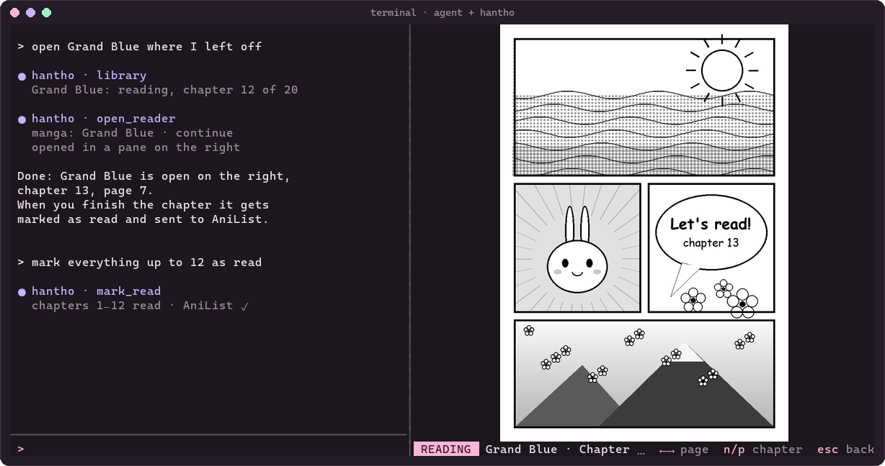

# Han Thỏ as an MCP server

**English** · [Español](mcp.es.md)

`hantho mcp` exposes Han Thỏ over [MCP](https://modelcontextprotocol.io) (stdio). That way a terminal
agent (Claude Code, Codex, Hermes, pi or any MCP client) can search for manga, browse your library,
mark chapters and **open the reader in a pane next to the chat**.



## Tools

| Tool | What it does |
|---|---|
| `search_manga` | Search a title across every installed source at once (up to ~25 s); by default only in the languages chosen in the TUI |
| `library` | Your favorites with status, progress, last chapter and AniList link |
| `chapters` | A manga's chapters, showing which are read (`from`, `to`, `unread_only`, `limit`) |
| `mark_read` | Mark or unmark a chapter, or every chapter up to a number; updates AniList if linked |
| `set_favorite` | Add or remove a manga from favorites; when adding, links it to AniList on an exact title match |
| `open_reader` | Open the reader in a side pane (or a new window), by default where you left off |
| `link_anilist` | Link a favorite to its AniList entry and sync; if unsure, returns candidates to pick from |
| `sync_anilist` | Send a linked favorite's status and progress to AniList |

Things you can ask the agent:

- "Open Grand Blue where I left off"
- "Which chapter am I on for each manga in my library?"
- "Search for *Dungeon Meshi* in English sources and add it to favorites"
- "Mark Grand Blue chapters up to 60 as read"
- "Link Grand Blue to my AniList"

> Having the AniList account connected isn't enough: each manga is linked once to its AniList entry
> (the same title can have a manga, a novel and spin-offs). Adding a favorite links it automatically on
> an exact title match; otherwise, `link_anilist` (or the `a` key in the TUI).

The tool descriptions and replies follow the system language too (Spanish or English; `HANTHO_LANG`
forces one).

## Side pane

`open_reader` splits the terminal window the agent is running in and opens Han Thỏ on the right:

| Terminal | How |
|---|---|
| Windows Terminal | `wt -w 0 split-pane` (Sixel images work per pane) |
| tmux | `tmux split-window -h` |
| WezTerm | `wezterm cli split-pane --right` |
| zellij | `zellij run --direction right` |
| kitty | `kitty @ launch --location=vsplit` (needs `allow_remote_control yes`) |

If the terminal can't be split, a new window opens instead (`placement: "window"` forces it).
You can do the same by hand: `hantho open "grand blue" --continue --side`.

The library and read chapters are shared: if the agent marks something while the TUI is open, the TUI
reloads it by itself within a couple of seconds.

## Connecting it

Use the full path to the binary. On Windows, for example,
`C:\Users\<you>\hantho\reader\target\release\hantho.exe`; on Linux,
`/path/to/repo/reader/target/release/hantho`.

### Claude Code

```bash
claude mcp add --scope user hantho -- /path/to/hantho mcp
```

### Codex CLI

In `~/.codex/config.toml`:

```toml
[mcp_servers.hantho]
command = "/path/to/hantho"
args = ["mcp"]
```

### Other clients (`mcpServers` format)

```json
{
  "mcpServers": {
    "hantho": { "command": "/path/to/hantho", "args": ["mcp"] }
  }
}
```

If Java isn't on the agent's `PATH`, add the `JAVA_HOME` variable to the server config
(`"env": { "JAVA_HOME": "…" }`).

## Details

- JSON-RPC 2.0 over stdio, one message per line; protocol versions `2025-06-18`, `2025-03-26` and
  `2024-11-05`.
- The extension host (JVM) starts with the first tool that needs it and is reused afterwards.
- Searches and chapters use the same cache as the TUI, and AniList the same rate limiter.
- Diagnostics go to stderr and host errors to `~/.hantho/host.log`.
